<a id="top"></a>
<div align="center">

# `IT25104031`

### Software Engineering Student


<br>

[](https://github.com/IT25104031)

</div>

---

## `> whoami`

```text
Software Engineering student
Interested in software development
Learning by building real projects
Always experimenting with new technologies
```

---

## `> tech_stack`

### Languages

<p>

</p>

### Tools & Technologies

<p>

</p>

---

## `> currently_learning`

```text
Spring Boot
REST APIs
Database Design
Software Engineering
Git & GitHub
```

---

## `> projects`

| Project                         | Description                                |
| ------------------------------- | ------------------------------------------ |
| 🌐 **Travel Management System** | Collaborative software engineering project |
| ⚙️ **RentFlow**                 | Equipment rental management application    |
| 💻 **C Projects**               | Academic programming projects              |

> More projects coming soon...

---

## `> github_stats`

<div align="center">


</div>

---

## `> contribution_activity`

<div align="center">


</div>

---

## `> PACMAN`

<div align="center">



</div>

---

## `> connect`

<div align="center">

<a href="https://github.com/IT25104031">
  
</a>

<a href="https://ashenmaha.netlify.app/">
  
</a>

<a href="https://www.facebook.com/ashen.maharamba">
  
</a>

<a href="https://www.instagram.com/captain_ashen/">
  
</a>

</div>

---

<div align="center">

---

<div align="center">

<br>


<br>

<sub>Thanks for stopping by — see you in the next commit.</sub>

<br><br>

<a href="#top">
  
</a>

<br><br>

</div>
